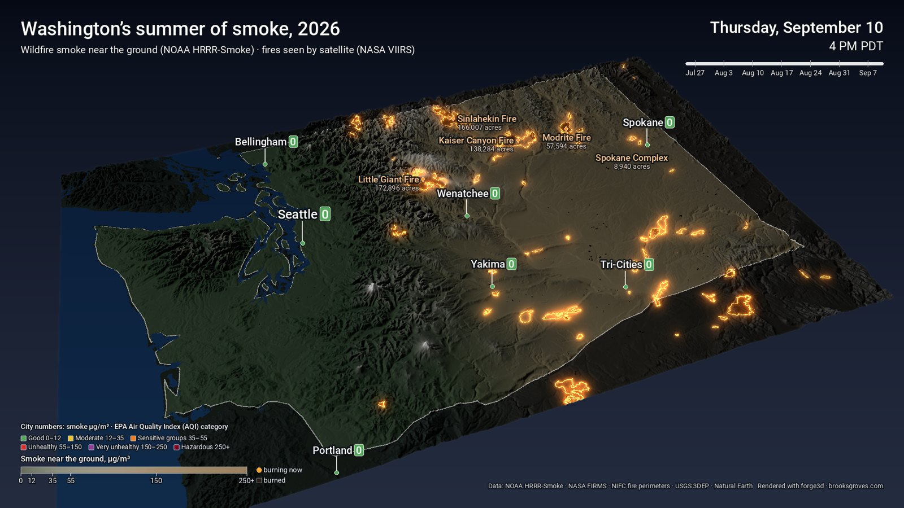

# Washington's summer of smoke, 2026



This project animates wildfire smoke and fire across Washington from late July to mid-September 2026, rendered over 3D terrain with [forge3d](https://github.com/milos-agathon/forge3d). Each frame is one hour. The camera drifts slowly from the south-southwest, and at the end it holds while the official fire perimeters are traced in.

On screen:

- **Smoke** is hourly near-surface smoke from NOAA's HRRR-Smoke model, drawn as a haze over the land. It goes from pale grey at low concentrations to brown when it's heavy.
- **Fires:**
  - Satellite fire detections (NASA FIRMS, VIIRS) glow orange for 12 hours.
  - After that they leave a charcoal burn scar, so each fire grows night by night.
- **Labels:**
  - Big fires are named when satellites first see them burning.
  - The Spokane Complex gets one label covering its three fires.
- **Cities** show their smoke reading, coloured by the EPA's PM2.5 categories (green, yellow, orange, red, purple, maroon).

Inspired by Milos Popovic's ([@milos_gis](https://x.com/milos_gis)) wildfire smoke animations.

## Run it

```powershell
pixi install
pixi run fires --key YOUR_FIRMS_KEY   # once; the key is saved in data\firms_key.txt
pixi run stills                       # three finished frames to check the look
pixi run render                       # 16:9 -> out\wa_smoke_2026.mp4
pixi run render-square                # 1:1  -> out\wa_smoke_2026_1x1.mp4
pixi run render-portrait              # 4:5  -> out\wa_smoke_2026_4x5.mp4
```

**The FIRMS key** is free and arrives by email in a minute or two. Request it at <https://firms.modaps.eosdis.nasa.gov/api/map_key/>. Without it everything still works, but burns appear all at once when each fire is reported, instead of growing.

**Downloads.** The first run downloads everything into `data\`. Later runs reuse it.

- **Terrain and outline** are copied from `..\wa-heat-dome\data` if that project is next door. Otherwise they download from USGS and Natural Earth.
- **Smoke** is 1,152 hourly HRRR files from NOAA's open-data bucket on AWS. Only the smoke field is downloaded (about 1-2 MB per hour, ~2 GB total), 8 at a time. Each hour is cached in `data\cache\hrrr\`, so an interrupted run picks up where it stopped. Set `STEP_HOURS = 2` in `scripts/config.py` to halve the download.
- **Fire perimeters** come from NIFC's WFIGS service. No key needed.

## Render options

| Option | Default | What it does |
|---|---|---|
| `--frames-per-hour` | 1 | 1 frame an hour at 24 fps = a day a second, about 48 s |
| `--hold` | 4 | seconds to hold at the end while the perimeters appear |
| `--format` | 16x9 | 16x9, 1x1 or 4x5 |
| `--stills 216,456,end` | off | just these hours from the start (and/or the final frame), finished; the little MP4 it also writes is only those frames |
| `--hours N` | all | render only the first N hours (quick tests) |
| `--lite` | off | lighter shadows and antialiasing, for slower GPUs or if the viewer stalls |

To re-finish frames without re-rendering the 3D, run `pixi run finish`. The viewer's own messages go to `out\viewer.log`.

## How the smoke is drawn

Each frame is rendered twice:

1. **The land:** terrain, burn scars and active fires.
2. **The smoke alone**, at half size and colour-coded: red for smoke, blue for none. The viewer's lighting scales red and blue by the same factor, so the ratio between them still gives the smoke amount after shading.

The finishing pass reads that ratio back and lays the smoke over the land as an unshaded veil, so it looks like haze in the air rather than paint on the hills. Then it puts the fires back on top with a soft glow.

Water is painted a key green and swapped for blue afterwards, as in the heat-dome project.

## The notebook

**[notebooks/smoke.ipynb](notebooks/smoke.ipynb)** walks through how this is made, using the project's own scripts: the shared Washington canvas, HRRR-Smoke at the cities and VIIRS fire detections day by day, the two-pass red/blue smoke code, and three finished frames from the project's own `render.py --stills`. It's saved with its outputs, so it reads on GitHub without running anything.

To run it yourself: `pixi run stills` once first so the data is downloaded. Sections 1–3 need no renderer; section 4 opens the forge3d viewer and writes to `out/notebook/`, leaving the film alone (a GPU, or on Linux Mesa's software Vulkan under `xvfb-run`). It also needs matplotlib and Jupyter, which aren't in this project's pixi environment.

## Data

- **Smoke:** NOAA HRRR-Smoke (3 km, hourly), MASSDEN at 8 m above ground, from the [NOAA Open Data Dissemination bucket](https://registry.opendata.aws/noaa-hrrr-pds/) on AWS. For each hour, the 1-hour forecast from the previous run is used.
- **Fire detections:** NASA FIRMS, VIIRS 375 m (Suomi-NPP, NOAA-20, NOAA-21).
- **Fire perimeters:** NIFC WFIGS Interagency Fire Perimeters.
- **Terrain:** USGS 3DEP, 250 m. **Outline:** Natural Earth.

## Caveats

- HRRR-Smoke is a model driven by satellite fire observations, not a network of monitors. It's good at where the smoke goes and roughly how thick it is, but a city's number here won't match its air-quality monitor hour for hour.
- The PM2.5 colours on the city readings use the EPA's 24-hour category breakpoints as a familiar reference. The readings themselves are hourly smoke only.
- VIIRS sees each spot about twice a day and can miss fire under thick smoke or cloud, so growth is stepwise, and small fires can be missed entirely.

## Files

```
scripts/config.py          dates, area, colours, cities, formats
scripts/fetch_smoke.py     HRRR-Smoke via byte-range downloads
scripts/fetch_fires.py     FIRMS detections + WFIGS perimeters
scripts/drape.py           land, scars, fires and smoke for any hour
scripts/render.py          forge3d camera + frames (land pass and smoke pass)
scripts/finish.py          smoke veil, glow, labels, clock, legend, encode
```

Fonts: Roboto (Apache 2.0).
